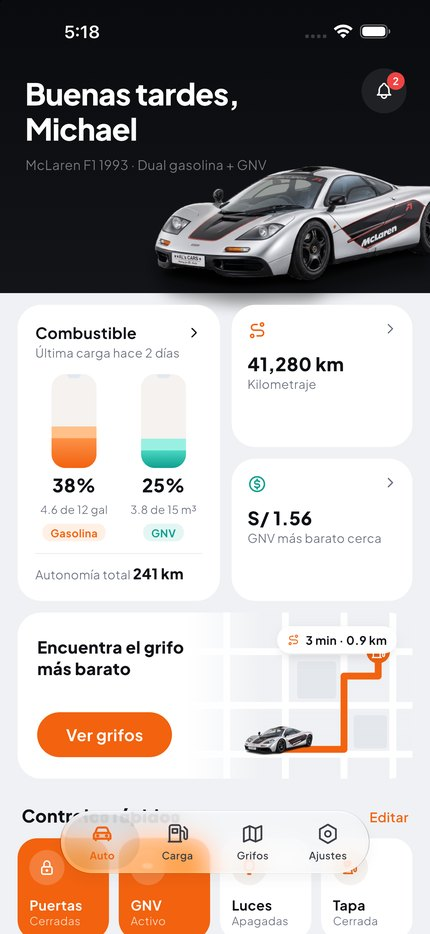
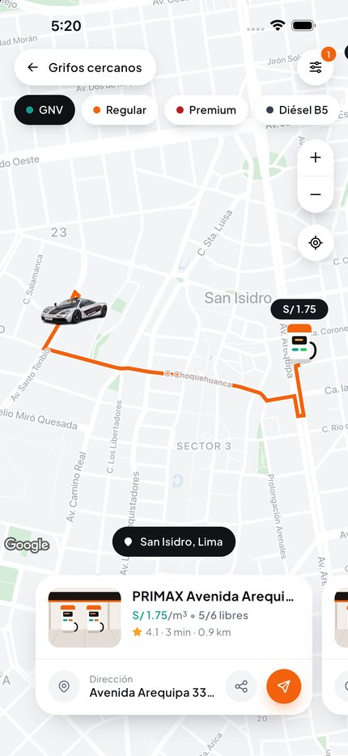
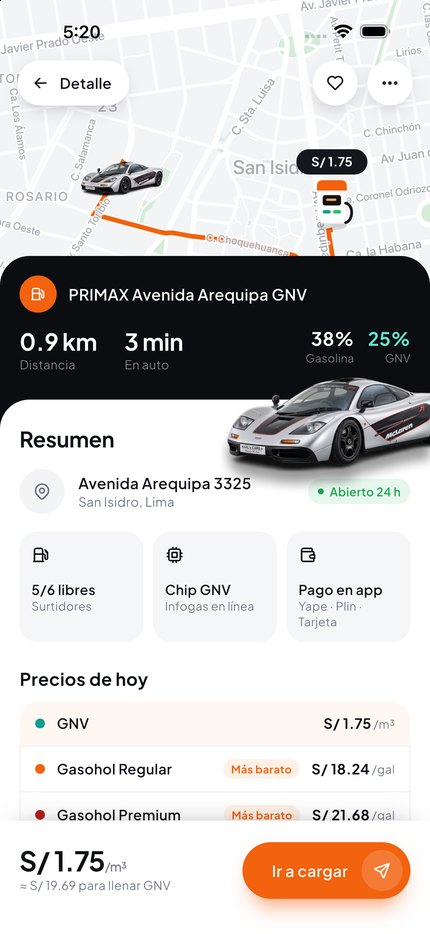
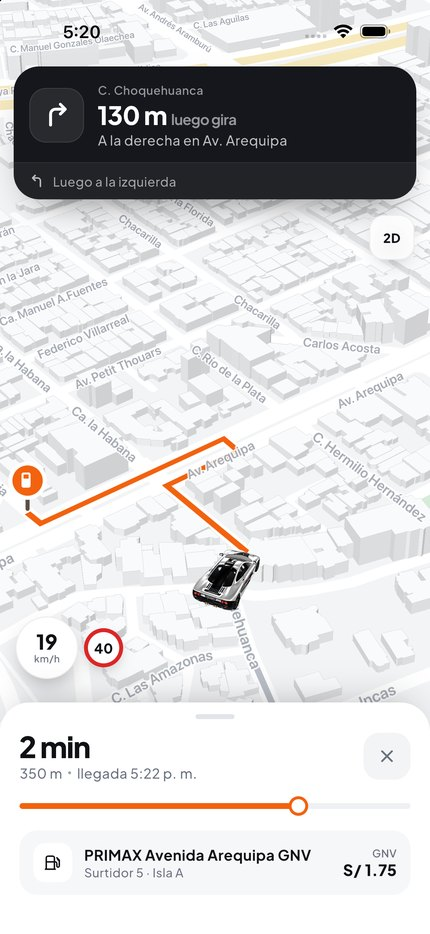
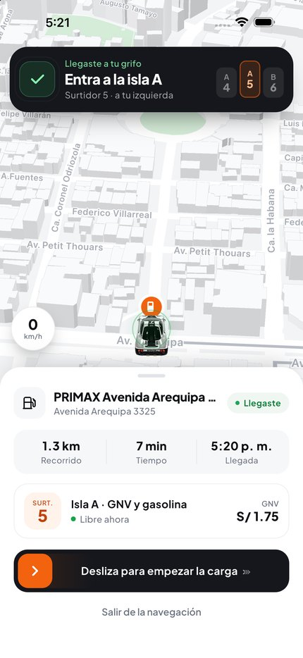
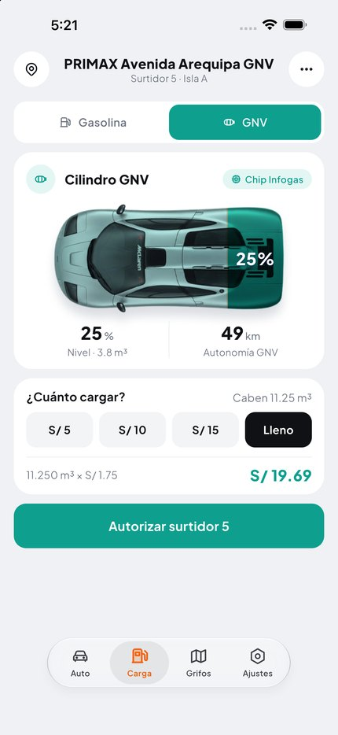
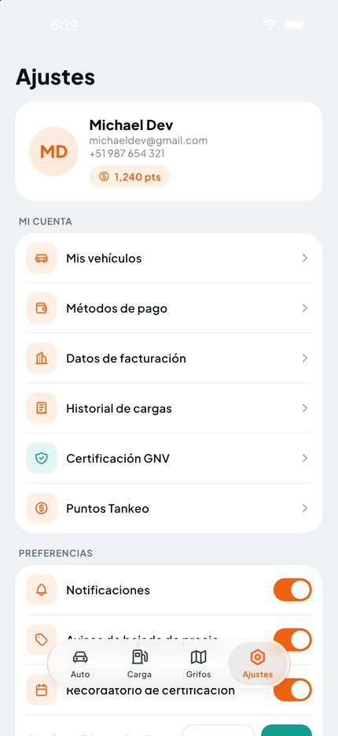
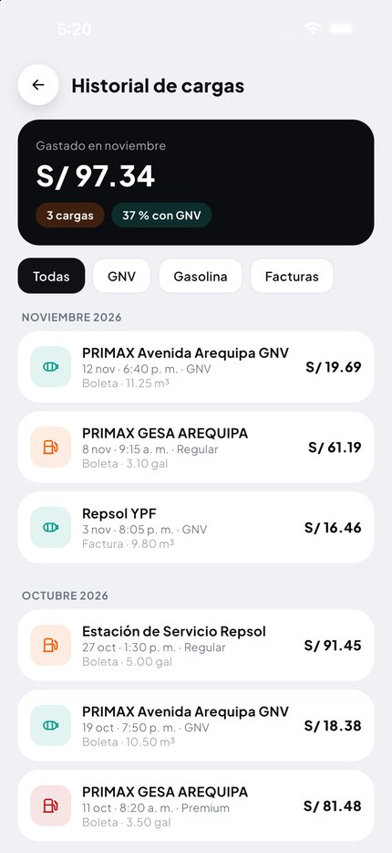
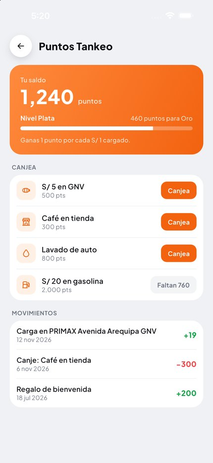

<div align="center">

# Tankeo

**Find the cheapest gas station in Lima, get there with turn-by-turn navigation, and fill up with gasoline or CNG (GNV) while paying from your car.**

[🇵🇪 Español](README.md) · 🇺🇸 English

[](https://flutter.dev)
[](https://dart.dev)
[](#)
[](#)
[](https://developers.google.com/maps)
[](https://bloclibrary.dev)
[](https://pub.dev/packages/go_router)
[](https://pub.dev/packages/liquid_glass_widgets)
[](test)
[](lib/l10n/app_es.arb)
[](LICENSE)

</div>

## Screenshots

> The app UI is in Spanish (Peru).

<table>
  <tr>
    <td align="center"><br><sub>Home</sub></td>
    <td align="center"><br><sub>Nearby stations</sub></td>
    <td align="center"><br><sub>Station detail</sub></td>
  </tr>
  <tr>
    <td align="center"><br><sub>3D navigation</sub></td>
    <td align="center"><br><sub>Arrival at the station</sub></td>
    <td align="center"><br><sub>Fueling</sub></td>
  </tr>
  <tr>
    <td align="center"><br><sub>Settings</sub></td>
    <td align="center"><br><sub>Fueling history</sub></td>
    <td align="center"><br><sub>Tankeo points</sub></td>
  </tr>
</table>

## Features

- **Real stations:** nearby gas stations come from Google Places. Each one shows CNG, Regular, Premium and Diesel B5 prices, and you can filter by fuel.
- **Real routes:** the polyline and the turn instructions come from the Google Routes API, with real street names.
- **Turn-by-turn navigation:**
  - An overview, then driving in 2D or 3D. The 3D view uses a 3D McLaren F1.
  - A speedometer, the speed limit and a recenter button.
- **Arrival:** shows your island and pump, and you slide to start fueling.
- **Fueling:** gasoline or CNG, the tank or cylinder level, quick amounts or a full tank, and pump authorization.
- **Payment and receipt:** Yape, Plin or card, and an electronic receipt (*boleta*) or invoice (*factura*) with a QR code.
- **Account:**
  - Login, sign up and password reset.
  - Vehicles, payment methods (cards are checked with the Luhn algorithm) and billing details.
  - History and notifications.
  - CNG certification, and points you can redeem.
- **Liquid Glass tab bar** (`GlassTabBar` from `liquid_glass_widgets`): it gets smaller when you scroll, and shows an orange dot while fueling is in progress.
- **Live Activity** with `live_island_kit`: the Dynamic Island on iOS and Live Updates on Android.
- **Error simulation:** from the ⋯ menu on the Fueling screen you can force certification, pump and payment errors.

## Tech stack

| Layer | Tools |
|---|---|
| State | `flutter_bloc`, `bloc_concurrency`, `equatable` |
| Routing | `go_router` (`ShellRoute` for the tabs) |
| DI | `get_it` |
| Maps | `google_maps_flutter`, Routes API, Places API |
| 3D | `model_viewer_plus` (`.glb` model) |
| UI | `liquid_glass_widgets`, `flutter_svg`, `qr_flutter`, 440 pt design canvas |
| Strings | `intl` + ARB (`lib/l10n/app_es.arb`) |
| Testing | `flutter_test`, `bloc_test`, `mocktail`, `alchemist` (golden tests) |

## Getting started

You need:

- Flutter 3.47.5 (see `.fvmrc`).
- Xcode or Android Studio.
- A Google Maps API key with **Maps SDK**, **Routes API** and **Places API** enabled.

```bash
git clone https://github.com/VMichael1999/tankeo.git
cd tankeo
flutter pub get
```

### Google Maps key

1. Copy `.env.example` to `.env` and set your key:
   ```bash
   cp .env.example .env
   # EXPO_PUBLIC_GOOGLE_MAPS_API_KEY=your_key
   ```
2. Android reads the key directly from `.env`. On iOS, run this once to generate `ios/Flutter/Env.xcconfig`:
   ```bash
   ./tool/sync_env.sh
   ```

`.env` and `Env.xcconfig` are in `.gitignore`, so the key is never committed.

### Run

```bash
flutter run
flutter run --dart-define=INITIAL_ROUTE=/map       # open a specific screen
flutter test                                       # unit, widget and golden tests
python3 tool/gen_arb.py && flutter gen-l10n        # after changing strings
```

To run on a physical iPhone, pick your signing team in Xcode.

## Project structure

```
lib/
├── app/                # router, AppShell (tab bar), DI (di.dart)
├── core/               # domain, theme, icons, l10n, toasts, shared widgets
└── features/
    ├── splash/ auth/   # splash, login, sign up, password reset
    ├── stations/       # map, detail, Places and Routes repositories
    ├── navigation/     # NavigationBloc, navigation mode and arrival
    ├── fueling/ queue/ # fueling and the queue at a full station
    ├── payment/ receipt/ # payment and receipt
    ├── account/        # settings, history, notifications, points, billing
    ├── vehicle/        # my vehicles
    └── certification/  # CNG certification
```

## 3D model

In 3D navigation, the car is the `assets/models/car.glb` model. It is rendered in a transparent `model-viewer` on top of the map. The 2D view uses a top-down photo instead.

**Credit:** "[McLaren F1 1993 by Alex.Ka.](https://sketchfab.com/3d-models/mclaren-f1-1993-by-alexka-294df724d96241cdbe0e0f3c91ad7fce)" by Alex.Ka., on Sketchfab. It is licensed under **CC BY-NC 4.0**, so it can only be used non-commercially and with credit to the author.

The file is optimized: the ground planes were removed, the textures were reduced to 1024 px and the mesh was simplified. That took it from 12.7 MB to 1.8 MB.

## License

© 2026 Michael Valdiviezo. **All rights reserved.** The code is published for reference only; it may not be used, copied or distributed without written permission. See [LICENSE](LICENSE).

The 3D model (`assets/models/car.glb`) keeps its CC BY-NC 4.0 license.

## Author

**Michael Valdiviezo**: [@VMichael1999](https://github.com/VMichael1999)
