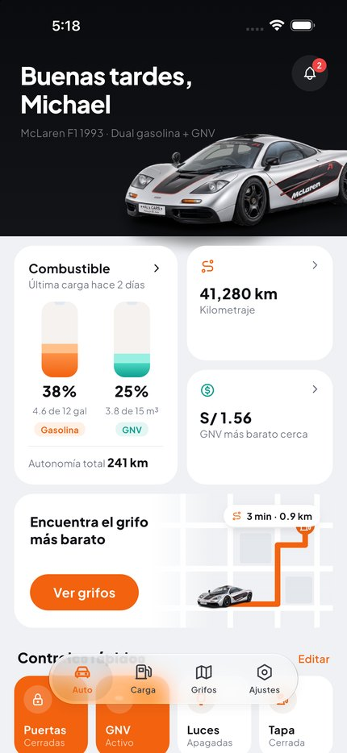
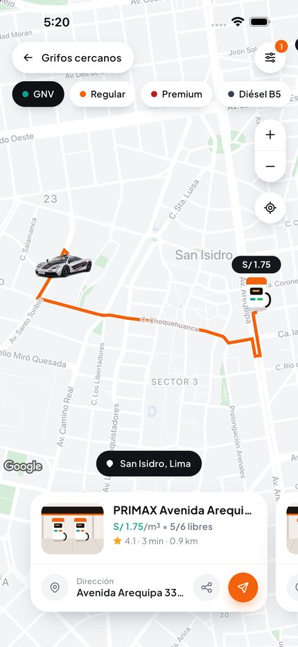
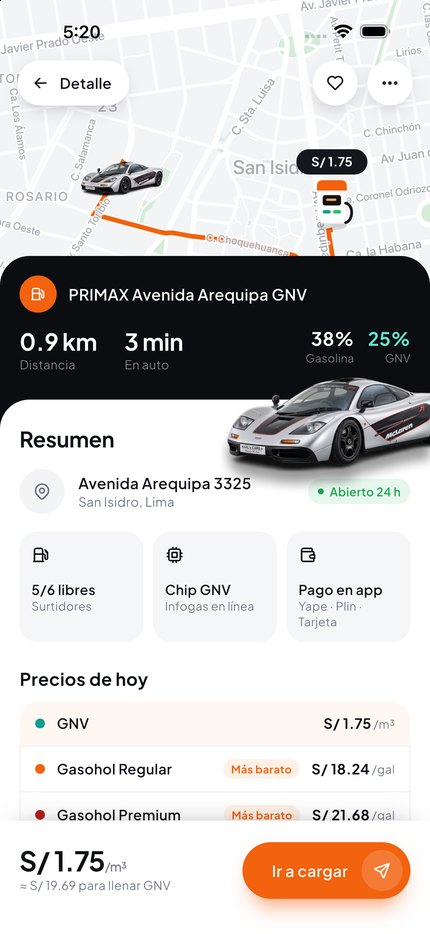
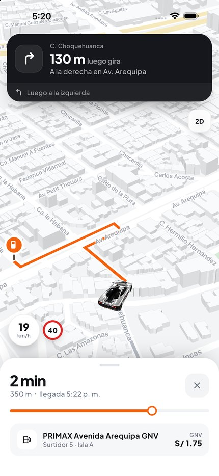
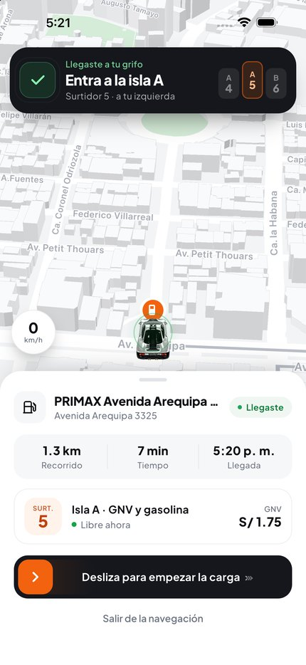
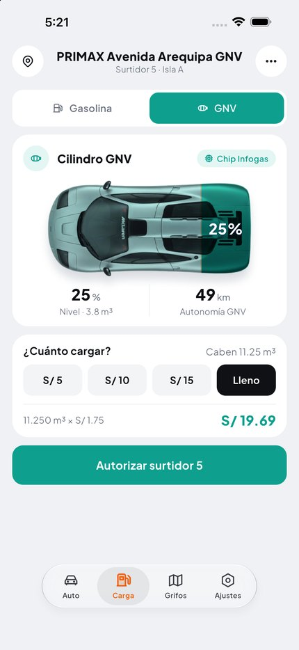
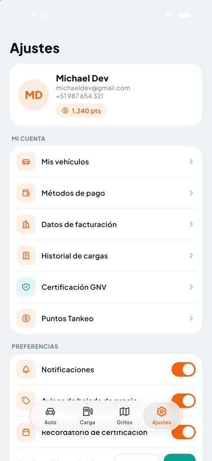
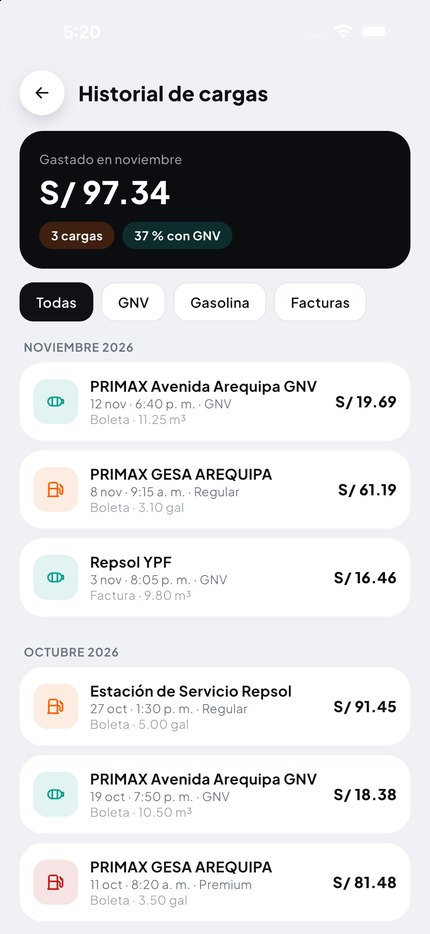
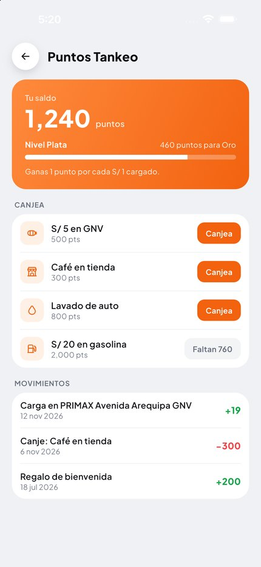

<div align="center">

# Tankeo

**Encuentra el grifo más barato de Lima, llega con navegación paso a paso y carga gasolina o GNV pagando desde el auto.**

🇵🇪 Español · [🇺🇸 English](README.en.md)

[](https://flutter.dev)
[](https://dart.dev)
[](#)
[](#)
[](https://developers.google.com/maps)
[](https://bloclibrary.dev)
[](https://pub.dev/packages/go_router)
[](https://pub.dev/packages/liquid_glass_widgets)
[](test)
[](lib/l10n/app_es.arb)
[](LICENSE)

</div>

## Capturas

<table>
  <tr>
    <td align="center"><br><sub>Inicio</sub></td>
    <td align="center"><br><sub>Grifos cercanos</sub></td>
    <td align="center"><br><sub>Detalle del grifo</sub></td>
  </tr>
  <tr>
    <td align="center"><br><sub>Navegación 3D</sub></td>
    <td align="center"><br><sub>Llegada al grifo</sub></td>
    <td align="center"><br><sub>Carga</sub></td>
  </tr>
  <tr>
    <td align="center"><br><sub>Ajustes</sub></td>
    <td align="center"><br><sub>Historial de cargas</sub></td>
    <td align="center"><br><sub>Puntos Tankeo</sub></td>
  </tr>
</table>

## Funcionalidades

- **Grifos reales:** gasolineras cercanas de Google Places, con precios de GNV, Regular, Premium y Diésel B5, y filtros por combustible.
- **Rutas reales:** la polilínea y las indicaciones salen de Google Routes API, con nombres de calles reales.
- **Navegación paso a paso:** vista general, conducción en 2D o 3D (con un McLaren F1 en 3D), velocímetro, límite de velocidad y recentrado.
- **Llegada:** te indica la isla y el surtidor, y deslizas para empezar la carga.
- **Carga:** gasolina o GNV, nivel del tanque o cilindro, montos rápidos o lleno, y autorización del surtidor.
- **Pago y comprobante:** Yape, Plin o tarjeta, y boleta o factura electrónica con QR.
- **Cuenta:**
  - Login, crear cuenta y recuperar contraseña.
  - Vehículos, métodos de pago (tarjeta validada con Luhn) y datos de facturación.
  - Historial y notificaciones.
  - Certificación GNV y puntos con canjes.
- **Barra de pestañas Liquid Glass** (`GlassTabBar` de `liquid_glass_widgets`):
  - Se compacta al hacer scroll.
  - Muestra un punto naranja cuando hay una carga en curso.
- **Live Activity** con `live_island_kit`: isla dinámica en iOS y Live Update en Android.
- **Simular errores:** desde el menú ⋯ de Carga puedes forzar fallos de certificación, del surtidor y del pago.

## Tecnología

| Capa | Herramientas |
|---|---|
| Estado | `flutter_bloc`, `bloc_concurrency`, `equatable` |
| Navegación | `go_router` (`ShellRoute` para las pestañas) |
| Inyección | `get_it` |
| Mapas | `google_maps_flutter`, Routes API, Places API |
| 3D | `model_viewer_plus` (modelo `.glb`) |
| UI | `liquid_glass_widgets`, `flutter_svg`, `qr_flutter`, lienzo de diseño de 440 pt |
| Textos | `intl` + ARB (`lib/l10n/app_es.arb`) |
| Pruebas | `flutter_test`, `bloc_test`, `mocktail`, `alchemist` (goldens) |

## Instalación

Requisitos: Flutter 3.47.5 (ver `.fvmrc`), Xcode o Android Studio, y una clave de Google Maps con **Maps SDK**, **Routes API** y **Places API** activadas.

```bash
git clone https://github.com/VMichael1999/tankeo.git
cd tankeo
flutter pub get
```

### Clave de Google Maps

1. Copia `.env.example` a `.env` y pon tu clave:
   ```bash
   cp .env.example .env
   # EXPO_PUBLIC_GOOGLE_MAPS_API_KEY=tu_clave
   ```
2. Android la lee directamente de `.env`. En iOS, ejecuta este comando una vez (genera `ios/Flutter/Env.xcconfig`):
   ```bash
   ./tool/sync_env.sh
   ```

`.env` y `Env.xcconfig` están en `.gitignore`: la clave nunca se sube al repositorio.

### Ejecutar

```bash
flutter run
flutter run --dart-define=INITIAL_ROUTE=/map       # abrir una pantalla directamente
flutter test                                       # pruebas unitarias, de widgets y goldens
python3 tool/gen_arb.py && flutter gen-l10n        # si cambias los textos
```

Para correr en un iPhone físico, elige tu equipo de firma en Xcode.

## Estructura

```
lib/
├── app/                # router, AppShell (barra de pestañas), inyección (di.dart)
├── core/               # dominio, tema, íconos, l10n, toasts, widgets compartidos
└── features/
    ├── splash/ auth/   # inicio, login, registro, recuperar contraseña
    ├── stations/       # mapa, detalle, repositorios de Places y Routes
    ├── navigation/     # NavigationBloc, modo navegación y llegada
    ├── fueling/ queue/ # carga y cola en grifo lleno
    ├── payment/ receipt/ # pago y comprobante
    ├── account/        # ajustes, historial, notificaciones, puntos, facturación
    ├── vehicle/        # mis vehículos
    └── certification/  # certificación GNV
```

## Modelo 3D

En la navegación 3D, el auto es el modelo `assets/models/car.glb`. Se muestra en un `model-viewer` transparente sobre el mapa; en 2D se usa la foto cenital.

**Crédito:** «[McLaren F1 1993 by Alex.Ka.](https://sketchfab.com/3d-models/mclaren-f1-1993-by-alexka-294df724d96241cdbe0e0f3c91ad7fce)» de Alex.Ka., en Sketchfab. Licencia **CC BY-NC 4.0**: solo uso no comercial y con crédito al autor.

El archivo está optimizado: sin planos de suelo, texturas a 1024 px y malla simplificada. Pasó de 12.7 MB a 1.8 MB.

## Licencia

© 2026 Michael Valdiviezo. **Todos los derechos reservados.** El código se publica solo para consulta; no se permite usarlo, copiarlo ni distribuirlo sin permiso por escrito. Ver [LICENSE](LICENSE).

El modelo 3D (`assets/models/car.glb`) conserva su licencia CC BY-NC 4.0.

## Autor

**Michael Valdiviezo**: [@VMichael1999](https://github.com/VMichael1999)
